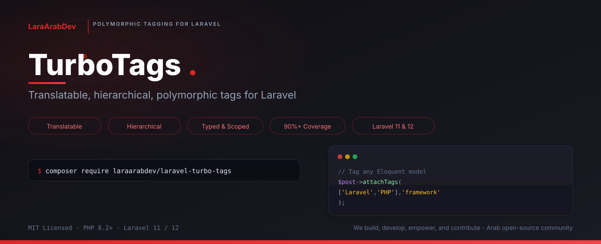

<div dir="rtl">

<p align="center">
    
</p>

<h1 align="center">TurboTags</h1>

<p align="center">
    <strong>طريقة ذكية وقوية لإدارة الوسوم والتصنيفات لأي موديل في Laravel</strong>
</p>

<p align="center">
    <a href="https://packagist.org/packages/laraarabdev/laravel-turbo-tags"></a>
    <a href="https://packagist.org/packages/laraarabdev/laravel-turbo-tags"></a>
    <a href="LICENSE"></a>
    <a href="https://php.net"></a>
    <a href="https://laravel.com"></a>
</p>

<p align="center">
    <a href="https://github.com/LaraArabDev/laravel-turbo-tags/actions/workflows/tests.yml"></a>
    <a href="https://codecov.io/gh/LaraArabDev/laravel-turbo-tags"></a>
    <a href="https://github.com/LaraArabDev/laravel-turbo-tags/actions/workflows/static-analysis.yml"></a>
    <a href="https://github.com/LaraArabDev/laravel-turbo-tags/actions/workflows/code-style.yml"></a>
</p>

<p align="center">
    PHP 8.2+ &middot; Laravel 11 / 12 &middot; تغطية اختبارات +95% &middot; PHPStan أعلى مستوى &middot; بدون أي اعتمادات خارجية
</p>

<p align="center">
    <a href="#البداية-السريعة">البداية السريعة</a> &middot;
    <a href="#لماذا-turbotags">لماذا TurboTags</a> &middot;
    <a href="#المميزات">المميزات</a> &middot;
    <a href="#الاستخدام">الاستخدام</a> &middot;
    <a href="#تقارير-وتحليلات-الوسوم">التقارير</a> &middot;
    <a href="#الإعدادات">الإعدادات</a> &middot;
    <a href="#الاعتمادات">الاعتمادات</a> &middot;
    <a href="#الاختبارات">الاختبارات</a> &middot;
    <a href="README.md">English</a>
</p>

<p align="center">
    <b><a href="https://github.com/LaraArabDev">LaraArabDev</a></b> — نبني، نطوّر، نُمكّن، ونُساهم. مجتمع عربي مفتوح المصدر يصنع حزم Laravel احترافية وجاهزة للإنتاج.
</p>

---

## ما هو TurboTags؟

**TurboTags** هو نظام ذكي ومتكامل لإدارة الوسوم (Tags) والتصنيفات (Labels) في Laravel. يمنحك طريقة قوية ومرنة لتنظيم وتصنيف **أي موديل Eloquent** — مقالات، منتجات، مستخدمين، طلبات، أو أي شيء آخر — باستخدام الوسوم.

بدلاً من بناء منطق الوسوم من الصفر أو تجميع عدة حزم معًا، يوفر لك TurboTags كل ما تحتاجه في حزمة واحدة:

- **وسوم لأي موديل** — أضف `HasTags` trait لأي موديل Eloquent وابدأ فورًا. trait واحد، موديلات غير محدودة.
- **تعدد اللغات مدمج** — أسماء الوسوم تُخزّن كـ JSON بدعم لغات غير محدود مع سلسلة بديلة تلقائية. لا حاجة لحزمة ترجمة خارجية.
- **تنظيم هرمي** — أنشئ أشجار وسوم مثل `برمجة > PHP > Laravel`. تنقّل بـ `ancestors()` للأعلى و `descendants()` للأسفل.
- **تصنيف حسب النوع** — جمّع الوسوم في فئات (مثل "لغة"، "إطار عمل"، "مهارة") باستخدام نصوص بسيطة أو PHP `BackedEnum` الآمن.
- **ملكية الوسوم** — يمكن أن تكون الوسوم عامة، أو ملك مستخدم، أو خاصة بفريق. مثالي للتطبيقات متعددة المستأجرين.
- **تحليل استخدام الوسوم** — تقارير مدمجة تعرض لك الوسوم الأكثر شعبية، والوسوم الرائجة، والوسوم المُنشأة حديثًا.
- **تخزين مؤقت ذكي** — طبقة تخزين مؤقت مدمجة مع إبطال تلقائي تُبقي تطبيقك سريعًا بدون بيانات قديمة.

سواء كنت تبني مدونة بتصنيفات، أو منصة تجارة إلكترونية بعلامات المنتجات، أو قاعدة معرفة بمواضيع، أو منصة اجتماعية بهاشتاقات — TurboTags يتعامل مع كل ذلك بواجهة برمجية نظيفة وبديهية.

---

## البداية السريعة

### التثبيت

</div>

```bash
composer require laraarabdev/laravel-turbo-tags
```

<div dir="rtl">

انشر ملف الإعدادات وقواعد البيانات، ثم شغّل الترحيل:

</div>

```bash
php artisan vendor:publish --tag="laravel-turbo-tags-config"
php artisan vendor:publish --tag="laravel-turbo-tags-migrations"
php artisan migrate
```

<div dir="rtl">

### الإعداد

أضف `HasTags` trait لأي موديل تريد إضافة وسوم له:

</div>

```php
use LaraArabDev\TurboTags\Concerns\HasTags;

class Post extends Model
{
    use HasTags;
}
```

<div dir="rtl">

### ابدأ بالوسوم

</div>

```php
// إضافة وسوم — تُنشأ تلقائيًا إن لم تكن موجودة
$post->attachTags(['Laravel', 'PHP', 'Open Source']);

// التحقق من الوسوم
$post->hasTag('Laravel'); // true

// البحث عن موديلات بوسوم محددة
Post::withAllTags(['Laravel', 'PHP'])->get();

// وسوم متعددة اللغات
$tag = Tag::create([
    'name' => ['en' => 'Technology', 'ar' => 'تقنية'],
]);
```

<div dir="rtl">

هذا كل شيء. لا إعداد معقد، لا اعتمادات خارجية، لا كود متكرر.

### المتطلبات

| المتطلب | الإصدار |
| --- | --- |
| PHP | 8.2 أو أعلى |
| Laravel | 11.x أو 12.x |
| حزم خارجية | **لا يوجد** — كل شيء مدمج |

---

## لماذا TurboTags؟

### ترجمة مدمجة — بدون حزم إضافية

حزم الوسوم الأخرى تتطلب تثبيت حزمة ترجمة منفصلة (مثل `spatie/laravel-translatable`) لدعم تعدد اللغات. TurboTags يخزّن الترجمات مباشرة كـ JSON في قاعدة البيانات مع سلسلة بديلة ذكية:

**ترتيب البحث:** اللغة المطلوبة → اللغة الأساسية في الإعدادات → لغة التطبيق → اللغة البديلة في الإعدادات → أول ترجمة متوفرة.

هذا يعني أن المستخدمين يرون دائمًا اسم وسم ذي معنى، حتى لو لم تكن الترجمة المفضلة موجودة بعد.

</div>

```php
$tag = Tag::create([
    'name' => ['en' => 'Technology', 'ar' => 'تقنية', 'fr' => 'Technologie'],
]);

$tag->getTranslatedName('ar'); // "تقنية"
$tag->getTranslatedName();     // يستخدم لغة التطبيق تلقائيًا
```

<div dir="rtl">

للتطبيقات أحادية اللغة، لا تحتاج إعداد أي شيء — فقط مرّر نصًا وسيغلّفه TurboTags بلغة التطبيق تلقائيًا.

### إدارة ذكية للوسوم لأي موديل

يستخدم TurboTags علاقات Laravel متعددة الأشكال (`morphToMany`)، مما يعني أن **نفس نظام الوسوم يعمل مع كل موديلاتك**. المقال والمنتج والمستخدم يمكنهم مشاركة نفس مجموعة الوسوم — أو يمكنك فصلهم بالنوع. لا تحتاج جدول وسوم منفصل لكل موديل.

</div>

```php
// نفس الوسوم، موديلات مختلفة
$post->attachTag('مميز');
$product->attachTag('مميز');

// ابحث عن كل شيء موسوم بـ "مميز"
$tag->taggedModels(Post::class);    // كل المقالات المميزة
$tag->taggedModels(Product::class); // كل المنتجات المميزة
```

<div dir="rtl">

### وسوم هرمية جاهزة للاستخدام

أنشئ أشجار وسوم مثل `برمجة → PHP → Laravel`. حمّل الأشجار الفرعية كاملة بعملية تحميل متلهفة واحدة. تنقّل للأعلى بـ `ancestors()` وللأسفل بـ `descendants()`. المراجع الدائرية تُمنع تلقائيًا على مستوى قاعدة البيانات والموديل.

### أمان الأنواع مع PHP enums

صنّف الوسوم باستخدام PHP `BackedEnum` الأصلي — بدون نصوص سحرية قابلة للخطأ الإملائي:

</div>

```php
enum TagType: string {
    case Language = 'language';
    case Framework = 'framework';
}

$post->attachTag('Laravel', TagType::Framework);
$post->syncTagsWithType(['PHP', 'Go'], TagType::Language);
```

<div dir="rtl">

### جودة مُختبرة للإنتاج

- **تغطية اختبارات +95%** عبر 101 اختبار
- **PHPStan أعلى مستوى** — صفر أخطاء في التحليل الثابت
- **Laravel Pint** — أسلوب كود متسق
- **حذف ناعم**، **إبطال التخزين المؤقت تلقائيًا**، **حماية من المراجع الدائرية**

---

## المميزات

| الميزة | الوصف |
| --- | --- |
| **وسوم متعددة الأشكال** | أضف وسومًا لأي موديل Eloquent باستخدام `morphToMany`. نظام وسوم واحد لتطبيقك بالكامل. |
| **ترجمة مدمجة** | أسماء وسوم متعددة اللغات مخزنة كـ JSON — بدون حزم ترجمة خارجية. سلسلة بديلة ذكية تضمن أن المستخدمين يرون دائمًا اسمًا. |
| **وسوم هرمية** | بنية شجرية أب-ابن مع تحميل متلهف متكرر. تنقّل بـ `ancestors()`، `descendants()`، `isRoot()`، `isLeaf()`. |
| **أنواع الوسوم** | صنّف الوسوم (مثل `language`، `framework`، `category`) بنصوص عادية أو PHP `BackedEnum` الآمن. |
| **ملكية الوسوم** | وسوم عامة، لكل مستخدم، أو لكل فريق. استعلم بـ `global()`، `ownedBy($user)`، `availableTo($user)`. |
| **نطاقات الاستعلام** | تصفية قوية: `withAllTags`، `withAnyTags`، `withoutTags`، `withTagsOfType`، `withTagCount`. |
| **تقارير الوسوم** | تحليلات: `mostPopular()`، `recent()`، `recentMostPopular()` — اكتشف الوسوم الرائجة والشائعة والجديدة. |
| **روابط نصية تلقائية** | Slugs صديقة للروابط تُولّد تلقائيًا من اسم اللغة الأساسية، مع ضمان التفرد (لواحق `-2`، `-3`). |
| **اقتراحات الوسوم** | بحث أثناء الكتابة مع حد أدنى قابل للإعداد وعدد نتائج محدد. |
| **تخزين مؤقت ذكي** | طبقة تخزين مؤقت قابلة للإعداد مع إبطال تلقائي عند الإنشاء/التحديث/الحذف. تأجيل الإبطال للعمليات المجمّعة. |
| **عمليات المزامنة** | استبدل الوسوم كليًا أو حسب النوع بـ `syncTags` و `syncTagsWithType`. أنواع الوسوم الأخرى تُحفظ أثناء المزامنة حسب النوع. |
| **تخزين البيانات الوصفية** | أرفق بيانات JSON عشوائية بأي وسم عبر عمود `metadata` — ألوان، أيقونات، أوصاف، أي شيء. |
| **ترتيب مخصص** | عمود `order_column` اختياري للترتيب اليدوي. استعلم بنطاق `ordered()`. |
| **حماية من المراجع الدائرية** | تمنع دورات أب-ابن غير صالحة تلقائيًا، حتى عبر الوسوم المحذوفة ناعمًا. ترمي `InvalidArgumentException` إذا اكتُشفت. |
| **حذف ناعم** | الوسوم تدعم الحذف الناعم. الأبناء يحصلون على `parent_id = null` عند حذف الأب. |
| **عمليات مجمّعة** | `findOrCreateMany` تجد الوسوم الموجودة وتُنشئ المفقودة بالجملة، مع إبطال تخزين مؤقت واحد فقط في النهاية. |

---

## الاستخدام

### إضافة وإزالة الوسوم

</div>

```php
// بالاسم — الوسوم تُنشأ تلقائيًا إن لم تكن موجودة
$post->attachTag('Laravel');
$post->attachTags(['Laravel', 'PHP', 'Testing']);

// بنموذج Tag أو بالمعرّف
$tag = Tag::findOrCreate('Laravel');
$post->attachTag($tag);
$post->attachTag($tag->id);

// مع نوع — صنّف وسومك
$post->attachTag('PHP', 'language');
$post->attachTag('Laravel', 'framework');

// مع نوع ولغة (للتطبيقات متعددة اللغات)
$post->attachTag('تقنية', 'category', 'ar');

// إزالة الوسوم
$post->detachTag('Laravel');
$post->detachTags(['Laravel', 'PHP']);
$post->removeAllTags();
```

<div dir="rtl">

### مزامنة الوسوم

المزامنة تستبدل كل الوسوم الحالية بالوسوم التي تقدمها. أسهل طريقة لتحديث وسوم الموديل من نموذج إرسال:

</div>

```php
// استبدال كل الوسوم على الموديل
$post->syncTags(['Laravel', 'PHP']);

// استبدال وسوم نوع محدد فقط (الأنواع الأخرى تُحفظ)
// مفيد عندما يكون لديك حقول وسوم منفصلة لكل فئة
$post->syncTagsWithType(['Python', 'Ruby'], 'language');
```

<div dir="rtl">

### التحقق من الوسوم

</div>

```php
$post->hasTag('Laravel');                // true / false
$post->hasAllTags(['Laravel', 'PHP']);   // true فقط إذا كانت جميعها موجودة
$post->hasAnyTags(['Laravel', 'Ruby']); // true إذا كان أيٌّ منها موجودًا

// التحقق مع النوع
$post->hasTag('PHP', 'language');        // true فقط إذا كان موسومًا كنوع "language"
```

<div dir="rtl">

### نطاقات الاستعلام

استخدم نطاقات الاستعلام للبحث عن موديلات بناءً على وسومها:

</div>

```php
// موديلات موسومة بكل هذه الوسوم (منطق AND)
Post::withAllTags(['Laravel', 'PHP'])->get();

// موديلات موسومة بأي من هذه الوسوم (منطق OR)
Post::withAnyTags(['Laravel', 'Python'])->get();

// موديلات غير موسومة بهذه الوسوم (استبعاد)
Post::withoutTags(['Deprecated'])->get();

// موديلات لها وسوم من نوع محدد
Post::withTagsOfType('language')->get();

// تحميل متلهف للوسوم لتجنب مشكلة N+1
Post::withTagsLoaded()->get();

// تحميل عدد الوسوم بدون تحميل الوسوم نفسها
Post::withTagCount()->get();
```

<div dir="rtl">

---

### الوسوم الهرمية

أنشئ أشجار وسوم بعلاقات أب-ابن. مفيد للتصنيفات، التصنيفات المتداخلة، أشجار المهارات، أو أي بنية هرمية طبيعية.

</div>

```php
// إنشاء شجرة: برمجة → PHP → Laravel
$programming = Tag::create(['name' => ['en' => 'Programming', 'ar' => 'برمجة']]);
$php = Tag::create(['name' => ['en' => 'PHP'], 'parent_id' => $programming->id]);
$laravel = Tag::create(['name' => ['en' => 'Laravel'], 'parent_id' => $php->id]);

// التنقل في الشجرة
$laravel->parent;               // → وسم PHP
$programming->children;         // → مجموعة [PHP]
$laravel->isLeaf();             // true (بدون أبناء)
$programming->isRoot();         // true (بدون أب)

// تحميل الشجرة الفرعية كاملة بعملية واحدة
$programming->load('childrenRecursive');

// الحصول على كل الأسلاف من الأسفل للأعلى
$laravel->ancestors();          // مجموعة: [PHP, Programming]

// الحصول على كل الأحفاد (مسطّحة)
$programming->descendants();    // مجموعة: [PHP, Laravel]

// استعلام الوسوم الجذرية فقط (بدون أب)
Tag::roots()->get();
```

<div dir="rtl">

**المراجع الدائرية تُمنع تلقائيًا.** تعيين أب الوسم لنفسه أو لأحد أحفاده يرمي `InvalidArgumentException`. هذه الحماية تعمل حتى عبر الوسوم المحذوفة ناعمًا، مع حد عمق 100 لمنع تجاوز المكدس.

---

### الترجمة (مدمجة)

TurboTags **لا** يحتاج أي حزمة ترجمة خارجية. الترجمات تُخزّن مباشرة في عمود JSON مع سلسلة بديلة تلقائية، لذا يرى المستخدمون دائمًا اسمًا ذا معنى.

</div>

```php
// إنشاء وسم بترجمات متعددة
$tag = Tag::create([
    'name' => ['en' => 'Technology', 'ar' => 'تقنية', 'fr' => 'Technologie'],
]);

// الحصول على الاسم المترجم
$tag->getTranslatedName('en');  // "Technology"
$tag->getTranslatedName('ar');  // "تقنية"
$tag->getTranslatedName();      // يستخدم لغة التطبيق تلقائيًا

// تعيين أو تحديث ترجمة
$tag->setTranslatedName('Tecnologia', 'es');
$tag->save();

// التحقق وعرض الترجمات
$tag->hasTranslation('ar');     // true
$tag->getTranslations();        // ['en' => 'Technology', 'ar' => 'تقنية', ...]
```

<div dir="rtl">

**سلسلة البحث:** اللغة المطلوبة → `locale.primary` في الإعدادات → `app()->getLocale()` → `locale.fallback` في الإعدادات → أول ترجمة متوفرة.

---

### ملكية الوسوم

حدد نطاق الوسوم لمستخدمين أو فرق أو أي موديل Eloquent. ضروري للتطبيقات متعددة المستأجرين أو الأنظمة التي يُنشئ فيها المستخدمون وسومهم الخاصة.

</div>

```php
// إنشاء وسم مملوك لمستخدم
$tag = Tag::create([
    'name' => ['en' => 'Favorites', 'ar' => 'المفضلة'],
    'owner_type' => User::class,
    'owner_id' => $user->id,
]);

// نطاقات استعلام الملكية
Tag::global()->get();               // وسوم بدون مالك (مشتركة عبر التطبيق)
Tag::ownedBy($user)->get();         // وسوم تابعة لهذا المستخدم
Tag::availableTo($user)->get();     // وسوم عامة + وسوم هذا المستخدم
```

<div dir="rtl">

---

### أنواع الوسوم و Enums

نظّم الوسوم في فئات. يمكنك استخدام نصوص عادية أو PHP `BackedEnum` الآمن (مُوصى به لتجنب الأخطاء الإملائية):

</div>

```php
// باستخدام النصوص
$post->attachTag('PHP', 'language');
Tag::ofType('language')->get();

// باستخدام BackedEnum (مُوصى به)
enum TagType: string
{
    case Category = 'category';
    case Label = 'label';
    case Language = 'language';
}

$tag = Tag::findOrCreate('PHP', TagType::Language, 'en');
$post->attachTag('Laravel', TagType::Category);
$post->syncTagsWithType(['PHP', 'Go'], TagType::Language);
Tag::ofType(TagType::Language)->get();
```

<div dir="rtl">

---

### اقتراحات الوسوم

أنشئ وظيفة الإكمال التلقائي والبحث أثناء الكتابة مع نظام الاقتراحات المدمج:

</div>

```php
// بحث عن وسوم تحتوي على "Lara"
$suggestions = Tag::suggestions('Lara');

// مع تصفية بالنوع واللغة وحد مخصص
$suggestions = Tag::suggestions('PH', 'language', 'en', 5);
```

<div dir="rtl">

الحد الأدنى لطول البحث قابل للإعداد (الافتراضي: حرفان) لمنع الاستعلامات العريضة جدًا التي تُرجع نتائج كثيرة.

---

### الوسوم النشطة / غير النشطة

الوسوم لديها علم `is_active` (افتراضي: `true`) للتحكم في الظهور. الوسوم غير النشطة تُستبعد تلقائيًا من `findOrCreate`، `suggestions`، ونطاقات الاستعلام (`withAllTags`، `withAnyTags`، `withoutTags`):

</div>

```php
// تعطيل وسم بدون حذفه
$tag->update(['is_active' => false]);

// استعلام الوسوم النشطة أو غير النشطة فقط
Tag::active()->get();
Tag::inactive()->get();

// الوسوم غير النشطة مخفية من حل الوسوم والنطاقات
Post::withAllTags(['Laravel'])->get(); // يتجاهل وسم "Laravel" غير النشط
Tag::suggestions('Lara');              // يتخطى الوسوم غير النشطة
```

<div dir="rtl">

هذا منفصل عن الحذف الناعم — استخدم `is_active` لتبديل الظهور، والحذف الناعم للحذف الفعلي.

---

### البيانات الوصفية للوسوم (Metadata)

أرفق بيانات JSON عشوائية بأي وسم عبر عمود `metadata`. استخدمه لتخزين الألوان، الأيقونات، الأوصاف، إعدادات العرض، أو أي حقول مخصصة يحتاجها تطبيقك:

</div>

```php
// إنشاء وسم مع بيانات وصفية
$tag = Tag::create([
    'name' => ['en' => 'Important', 'ar' => 'مهم'],
    'metadata' => [
        'color' => '#ff0000',
        'icon' => 'star',
        'description' => 'عناصر ذات أولوية عالية',
        'display_order' => 1,
    ],
]);

// الوصول لحقول البيانات الوصفية
$tag->metadata['color'];       // '#ff0000'
$tag->metadata['icon'];        // 'star'

// تحديث البيانات الوصفية
$tag->update([
    'metadata' => ['color' => '#00ff00', 'icon' => 'check', 'badge' => true],
]);

// استخدام مع الأنواع و enums
$tag = Tag::findOrCreate('PHP', TagType::Language, 'en');
$tag->update([
    'metadata' => ['color' => '#4F5B93', 'logo' => 'php.svg'],
]);

// استخدام البيانات الوصفية في العروض
@foreach($post->tags as $tag)
    <span style="background: {{ $tag->metadata['color'] ?? '#gray' }}">
        {{ $tag->getTranslatedName() }}
    </span>
@endforeach
```

<div dir="rtl">

البيانات الوصفية بدون مخطط — لا يوجد تحقق من المفاتيح التي تخزنها. تُحوّل تلقائيًا إلى مصفوفة PHP.

---

## تقارير وتحليلات الوسوم

يتضمن TurboTags طرق تقارير مدمجة لمساعدتك في فهم كيفية استخدام الوسوم عبر تطبيقك:

</div>

```php
use LaraArabDev\TurboTags\Models\Tag;

// الحصول على الوسوم الأكثر شعبية (مرتبة بعدد الاستخدام الإجمالي عبر كل الموديلات)
$topTags = Tag::mostPopular(10);             // أكثر 10 وسوم استخدامًا
$topLangs = Tag::mostPopular(5, 'language'); // أكثر 5 وسوم لغة استخدامًا

// الحصول على أحدث الوسوم المُنشأة
$newTags = Tag::recent(10);                  // أحدث 10 وسوم
$newLangs = Tag::recent(5, 'language');      // أحدث 5 وسوم لغة

// الحصول على الوسوم الرائجة — الأكثر شعبية في نافذة زمنية حديثة
$trending = Tag::recentMostPopular(10, 30);           // أكثر 10 في آخر 30 يوم
$trending = Tag::recentMostPopular(5, 7, 'language'); // أكثر 5 لغات في آخر 7 أيام
```

<div dir="rtl">

كل طرق التقارير تُرجع الوسوم مع خاصية `taggables_count` التي تعرض عدد الموديلات الموسومة بكل وسم. استخدمها لسحب الوسوم، أقسام الرائج، ودجات الشريط الجانبي، ولوحات تحكم المشرفين.

---

## التخزين المؤقت

فعّل طبقة التخزين المؤقت المدمجة للتطبيقات عالية الحركة. يُبطل التخزين المؤقت **تلقائيًا** عند إنشاء أو تحديث أو حذف الوسوم — بدون إبطال يدوي.

</div>

```php
// config/laravel-turbo-tags.php
'cache' => [
    'enabled' => true,
    'ttl' => 3600,             // عمر التخزين المؤقت بالثواني (ساعة واحدة)
    'store' => null,            // null = مشغّل التخزين الافتراضي لتطبيقك
    'key_prefix' => 'turbo_tags',
],
```

<div dir="rtl">

الطرق المُخزّنة مؤقتًا: `findOrCreate`، `allCached`، `allOfTypeCached`، `suggestions`.

</div>

```php
// الحصول على كل الوسوم من التخزين المؤقت (وصول متكرر سريع)
$tags = Tag::allCached();
$tags = Tag::allOfTypeCached('language');

// العمليات المجمّعة تستخدم تأجيل الإبطال — إبطال واحد فقط بدلاً من N
$tags = Tag::findOrCreateMany(['PHP', 'Laravel', 'Go']);

// إبطال يدوي إذا لزم الأمر
Tag::flushTagCache();
```

<div dir="rtl">

---

### findOrCreate — حل الوسوم بكفاءة

ابحث عن الوسوم الموجودة أو أنشئ جديدة في عملية واحدة:

</div>

```php
// وسم واحد — يستخدم التخزين المؤقت إذا كان مفعّلاً
$tag = Tag::findOrCreate('Laravel', 'framework', 'en');

// مجمّع — استعلام واحد للبحث عن الموجود، إنشاء للمفقود فقط، إبطال تخزين واحد
$tags = Tag::findOrCreateMany(['PHP', 'Laravel', 'Testing'], 'framework', 'en');
```

<div dir="rtl">

---

## الاعتمادات

### اعتمادات الإنتاج

TurboTags ليس لديه **أي اعتمادات حزم خارجية**. يحتاج فقط مكونات إطار Laravel الأساسية، الموجودة بالفعل في كل تطبيق Laravel:

| الحزمة | الإصدار | ما توفره |
| --- | --- | --- |
| `php` | ^8.2 | الحد الأدنى من إصدار PHP لميزات الأنواع الحديثة (enums، الوسائط المسماة) |
| `illuminate/contracts` | ^11.0 \| ^12.0 | واجهات عقود Laravel. توفر الواجهات الأساسية التي ينفّذها TurboTags، مما يضمن التوافق مع حاوية خدمات Laravel وحقن الاعتمادات. |
| `illuminate/database` | ^11.0 \| ^12.0 | طبقة Eloquent ORM وقاعدة البيانات في Laravel. يستخدمها TurboTags للموديلات، الترحيلات، العلاقات (morphToMany)، نطاقات الاستعلام، والحذف الناعم. هذا هو جوهر كيفية تخزين الوسوم والاستعلام عنها. |
| `illuminate/support` | ^11.0 \| ^12.0 | أدوات الدعم في Laravel (المجموعات، مساعدات Str، ServiceProvider، إلخ). تُستخدم لمزود الخدمة، إدارة التخزين المؤقت، توليد الروابط النصية، وعمليات المجموعات. |

**هذه ليست حزمًا إضافية تحتاج لتثبيتها.** تأتي مع كل تطبيق Laravel تلقائيًا. عند تشغيل `composer require laraarabdev/laravel-turbo-tags`، يحلّها Composer من تثبيت Laravel الموجود لديك. بدون تحميلات إضافية، بدون تعارضات اعتمادات، بدون تضخم.

### اعتمادات التطوير (لا تُثبّت في تطبيقك)

هذه الحزم تُستخدم فقط لتطوير واختبار TurboTags نفسه. **لا** تُثبّت عندما تطلب TurboTags في مشروعك:

| الحزمة | الغرض |
| --- | --- |
| `pestphp/pest` | إطار اختبار — يشغّل مجموعة الـ 101 اختبار |
| `pestphp/pest-plugin-laravel` | مساعدات اختبار Pest خاصة بـ Laravel |
| `orchestra/testbench` | يحاكي بيئة تطبيق Laravel كاملة لاختبار الحزم |
| `phpstan/phpstan` | تحليل ثابت لاكتشاف أخطاء الأنواع قبل وقت التشغيل |
| `larastan/larastan` | قواعد PHPStan مخصصة لاتفاقيات Laravel |
| `laravel/pint` | مُصحّح أسلوب الكود للحفاظ على تنسيق متسق |

---

## الإعدادات

بعد نشر ملف الإعدادات (`php artisan vendor:publish --tag="laravel-turbo-tags-config"`)، ستجده في `config/laravel-turbo-tags.php`:

</div>

```php
return [
    // استخدم موديل Tag مخصص (وسّع Tag الأساسي إذا احتجت سلوكًا مخصصًا)
    'tag_model' => \LaraArabDev\TurboTags\Models\Tag::class,

    // أسماء جداول قاعدة البيانات — خصّصها إذا تعارضت مع جداولك الحالية
    'tables' => [
        'tags' => 'tags',
        'taggables' => 'taggables',
    ],

    // إعدادات اللغة للترجمة
    // اضبط على null لاستخدام لغة تطبيقك (config('app.locale'))
    'locale' => [
        'primary' => 'ar',       // مثال: 'ar' أو 'en'
        'fallback' => 'en',      // مثال: 'en'
    ],

    // توليد الروابط النصية — ينشئ slugs صديقة للروابط من أسماء الوسوم تلقائيًا
    'slugger' => [
        'source' => 'name',
        'generate_on_create' => true,   // توليد slug تلقائيًا عند الإنشاء
        'generate_unique' => true,      // إضافة -2، -3، إلخ لضمان التفرد
    ],

    // التخزين المؤقت — فعّله في الإنتاج لبحث أسرع عن الوسوم
    'cache' => [
        'enabled' => false,      // اضبط على true في الإنتاج
        'ttl' => 3600,           // عمر التخزين المؤقت بالثواني
        'store' => null,         // null = مشغّل التخزين الافتراضي لتطبيقك
        'key_prefix' => 'turbo_tags',
    ],

    // ضبط الأداء
    'performance' => [
        'chunk_size' => 1000,    // حجم الدفعة لعمليات قاعدة البيانات المجمّعة
    ],

    // إعدادات الاقتراحات / الإكمال التلقائي
    'suggestions' => [
        'limit' => 10,           // الحد الأقصى لعدد الاقتراحات المُرجعة
        'min_length' => 2,       // الحد الأدنى من الأحرف قبل تفعيل الاقتراحات
    ],
];
```

<div dir="rtl">

---

## هيكل قاعدة البيانات

ينشئ TurboTags جدولين عند تشغيل الترحيل:

### جدول `tags`

| العمود | النوع | الوصف |
| --- | --- | --- |
| `id` | bigint (PK) | المفتاح الأساسي |
| `name` | JSON | اسم الوسم — يخزن الترجمات كـ `{"en": "Tech", "ar": "تقنية"}` |
| `slug` | string (فريد) | معرّف صديق للروابط يُولّد تلقائيًا |
| `type` | string (قابل للنل، مفهرس) | فئة الوسم — مثل "language"، "framework" |
| `order_column` | integer (قابل للنل) | ترتيب يدوي اختياري |
| `is_active` | boolean (افتراضي: true) | هل الوسم نشط (الوسوم غير النشطة تُستبعد من الاستعلامات) |
| `metadata` | JSON (قابل للنل) | بيانات JSON عشوائية لحقول مخصصة |
| `owner_type` | string (قابل للنل) | فئة موديل المالك المتعدد الأشكال |
| `owner_id` | bigint (قابل للنل) | معرّف موديل المالك المتعدد الأشكال |
| `parent_id` | bigint (قابل للنل، مفهرس) | مفتاح خارجي ذاتي المرجع للتسلسل الهرمي |
| `created_at` | timestamp | ختم زمن الإنشاء |
| `updated_at` | timestamp | ختم زمن آخر تحديث |
| `deleted_at` | timestamp (قابل للنل) | ختم زمن الحذف الناعم |

### جدول `taggables` (جدول ربط)

| العمود | النوع | الوصف |
| --- | --- | --- |
| `id` | bigint (PK) | المفتاح الأساسي |
| `tag_id` | bigint (FK) | يشير إلى `tags.id` — يُحذف تتابعيًا |
| `taggable_type` | string | اسم فئة الموديل الموسوم |
| `taggable_id` | bigint | معرّف الموديل الموسوم |
| `created_at` | timestamp | متى أُرفق الوسم |
| `updated_at` | timestamp | آخر تحديث |

قيد تفرد على `(tag_id, taggable_id, taggable_type)` يمنع إرفاق الوسوم المكررة.

---

## الاختبارات

الحزمة تحتوي على **101 اختبار** مع **تغطية +95%** وتجتاز **PHPStan بأعلى مستوى**.

</div>

```bash
# تشغيل كل الاختبارات
composer test

# تشغيل الاختبارات مع تقرير التغطية
composer test-coverage

# التحليل الثابت (PHPStan أعلى مستوى)
composer analyse

# فحص أسلوب الكود (Laravel Pint)
composer format-test

# إصلاح أسلوب الكود تلقائيًا
composer format
```

<div dir="rtl">

---

## مرجع API

### طرق `HasTags` Trait — لموديلاتك

| الطريقة | الوصف |
| --- | --- |
| `tags()` | تُرجع علاقة `morphToMany` للوسوم |
| `tagsOfType($type)` | الحصول على وسوم مفلترة بالنوع |
| `attachTag($tags, $type, $locale)` | إرفاق وسم أو أكثر |
| `attachTags($tags, $type, $locale)` | اسم بديل لـ `attachTag` |
| `detachTag($tags, $type, $locale)` | فصل وسم أو أكثر |
| `detachTags($tags, $type, $locale)` | اسم بديل لـ `detachTag` |
| `syncTags($tags, $type, $locale)` | استبدال كل الوسوم (أو حسب النوع) |
| `syncTagsWithType($tags, $type, $locale)` | مزامنة وسوم نوع محدد فقط، مع حفظ الأنواع الأخرى |
| `removeAllTags()` | إزالة كل الوسوم من الموديل |
| `hasTag($tag, $type, $locale)` | التحقق من وجود وسم محدد |
| `hasAllTags($tags, $type, $locale)` | التحقق من وجود كل الوسوم المعطاة |
| `hasAnyTags($tags, $type, $locale)` | التحقق من وجود أي من الوسوم المعطاة |

### نطاقات استعلام `HasTags` Trait

| النطاق | الوصف |
| --- | --- |
| `withAllTags($tags, $type, $locale)` | موديلات لها كل الوسوم المحددة |
| `withAnyTags($tags, $type, $locale)` | موديلات لها أي من الوسوم المحددة |
| `withoutTags($tags, $type, $locale)` | موديلات بدون الوسوم المحددة |
| `withTagsOfType($type)` | موديلات لها وسم واحد على الأقل من النوع المعطى |
| `withTagsLoaded()` | تحميل متلهف لعلاقة `tags` |
| `withTagCount()` | إضافة خاصية `tags_count` للاستعلام |

### طرق ثابتة لموديل `Tag`

| الطريقة | الوصف |
| --- | --- |
| `Tag::findOrCreate($name, $type, $locale)` | البحث عن وسم موجود أو إنشاء جديد |
| `Tag::findOrCreateMany($names, $type, $locale)` | بحث أو إنشاء مجمّع لعدة وسوم |
| `Tag::allCached()` | الحصول على كل الوسوم من التخزين المؤقت |
| `Tag::allOfTypeCached($type)` | الحصول على وسوم مخزنة مفلترة بالنوع |
| `Tag::suggestions($search, $type, $locale, $limit)` | البحث عن اقتراحات وسوم (إكمال تلقائي) |
| `Tag::flushTagCache()` | إبطال كل الوسوم المخزنة يدويًا |
| `Tag::mostPopular($limit, $type)` | الحصول على الوسوم مرتبة بعدد الاستخدام |
| `Tag::recent($limit, $type)` | الحصول على أحدث الوسوم المُنشأة |
| `Tag::recentMostPopular($limit, $days, $type)` | الحصول على الوسوم الشائعة في نافذة زمنية |

### نطاقات استعلام موديل `Tag`

| النطاق | الوصف |
| --- | --- |
| `Tag::active()` | الوسوم النشطة فقط (`is_active = true`) |
| `Tag::inactive()` | الوسوم غير النشطة فقط (`is_active = false`) |
| `Tag::roots()` | الوسوم الجذرية فقط (بدون أب) |
| `Tag::global()` | الوسوم بدون مالك فقط |
| `Tag::ownedBy($model)` | الوسوم المملوكة لموديل محدد |
| `Tag::availableTo($model)` | الوسوم العامة + الوسوم المملوكة للموديل |
| `Tag::ofType($type)` | تصفية بنوع الوسم |
| `Tag::containing($search, $locale)` | الوسوم التي يحتوي اسمها على نص البحث |
| `Tag::ordered($direction)` | الترتيب حسب `order_column` |
| `Tag::withSlug($slug)` | البحث بالرابط النصي |

### طرق مثيل موديل `Tag`

| الطريقة | الوصف |
| --- | --- |
| `$tag->parent` | الحصول على الوسم الأب (علاقة BelongsTo) |
| `$tag->children` | الحصول على الأبناء المباشرين (علاقة HasMany) |
| `$tag->childrenRecursive` | الحصول على الشجرة الفرعية كاملة، قابلة للتحميل المتلهف |
| `$tag->ancestors()` | الحصول على كل الأسلاف من الأسفل للأعلى |
| `$tag->descendants()` | الحصول على كل الأحفاد، مسطّحة |
| `$tag->isRoot()` | تُرجع `true` إذا لم يكن للوسم أب |
| `$tag->isLeaf()` | تُرجع `true` إذا لم يكن للوسم أبناء |
| `$tag->getTranslatedName($locale)` | الحصول على اسم الوسم بلغة محددة |
| `$tag->setTranslatedName($value, $locale)` | تعيين أو تحديث ترجمة |
| `$tag->getTranslations()` | الحصول على كل الترجمات كمصفوفة |
| `$tag->hasTranslation($locale)` | التحقق من وجود ترجمة محددة |
| `$tag->taggedModels(Model::class)` | الحصول على كل موديلات فئة معينة موسومة بهذا الوسم |

---

## سجل التغييرات

راجع [CHANGELOG](CHANGELOG.md) لمعرفة المزيد عن التغييرات الأخيرة.

## المساهمة

نرحب بمساهمات المجتمع! راجع [دليل المساهمة](.github/CONTRIBUTING.md) للتفاصيل. كل المساهمات يجب أن تستوفي [معايير القبول](.github/CONTRIBUTING.md#acceptance-criteria).

## الأمان

راجع [سياسة الأمان](SECURITY.md) لمعرفة كيفية الإبلاغ عن الثغرات الأمنية. **لا** تفتح issue عام.

## الرخصة

رخصة MIT. راجع [ملف الرخصة](LICENSE.md) لمزيد من المعلومات.

---

</div>

<p align="center">
    <sub>صُنع بـ &#10084; بواسطة <a href="https://github.com/LaraArabDev">LaraArabDev</a> — مجتمع عربي مفتوح المصدر</sub>
</p>
