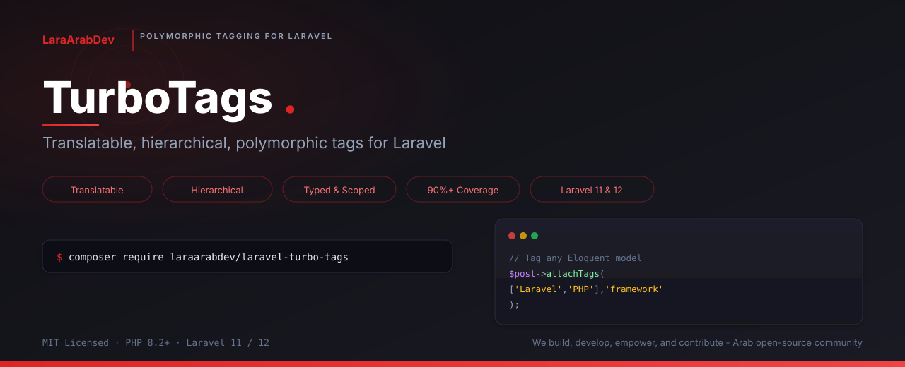

<p align="center">
    
</p>

<h1 align="center">TurboTags</h1>

<p align="center">
    <strong>Translatable, hierarchical, polymorphic tags for Laravel — zero external dependencies.</strong>
</p>

<p align="center">
    <a href="https://packagist.org/packages/laraarabdev/laravel-turbo-tags"></a>
    <a href="https://packagist.org/packages/laraarabdev/laravel-turbo-tags"></a>
    <a href="LICENSE"></a>
    <a href="https://php.net"></a>
    <a href="https://laravel.com"></a>
</p>

<p align="center">
    <a href="https://github.com/LaraArabDev/laravel-turbo-tags/actions/workflows/tests.yml"></a>
    <a href="https://codecov.io/gh/LaraArabDev/laravel-turbo-tags"></a>
    <a href="https://github.com/LaraArabDev/laravel-turbo-tags/actions/workflows/static-analysis.yml"></a>
    <a href="https://github.com/LaraArabDev/laravel-turbo-tags/actions/workflows/code-style.yml"></a>
    <a href="https://github.com/LaraArabDev/laravel-turbo-tags/actions/workflows/mutation-testing.yml"></a>
</p>

<p align="center">
    PHP 8.2 – 8.4 · Laravel 11 / 12 / 13
</p>

<p align="center">
    <b><a href="https://github.com/LaraArabDev">LaraArabDev</a></b> — We build, develop, empower, and contribute.<br>
    <b><a href="https://github.com/LaraArabDev">LaraArabDev</a></b> — نبني، نطوّر، نُمكّن، ونُساهم.
</p>

---

## Install

```bash
composer require laraarabdev/laravel-turbo-tags
php artisan vendor:publish --tag="laravel-turbo-tags-config"
php artisan vendor:publish --tag="laravel-turbo-tags-migrations"
php artisan migrate
```

Add the trait to any model:

```php
use LaraArabDev\TurboTags\Concerns\HasTags;

class Post extends Model
{
    use HasTags;
}
```

## Usage

### Attach & Detach

```php
$post->attachTags(['Laravel', 'PHP', 'Open Source']);
$post->attachTag('PHP', 'language');        // with type
$post->attachTag('تقنية', 'category', 'ar'); // with type + locale

$post->detachTag('Laravel');
$post->detachTags(['Laravel', 'PHP']);
$post->removeAllTags();
```

### Sync

```php
$post->syncTags(['Laravel', 'PHP']);                     // replace all
$post->syncTagsWithType(['Python', 'Ruby'], 'language'); // replace only this type
```

### Check

```php
$post->hasTag('Laravel');                // true / false
$post->hasAllTags(['Laravel', 'PHP']);   // all present?
$post->hasAnyTags(['Laravel', 'Ruby']); // any present?
```

### Query Scopes

```php
Post::withAllTags(['Laravel', 'PHP'])->get();   // AND
Post::withAnyTags(['Laravel', 'Python'])->get(); // OR
Post::withoutTags(['Deprecated'])->get();        // NOT
Post::withTagsOfType('language')->get();
Post::withTagsLoaded()->get();                   // eager load
Post::withTagCount()->get();                     // count only
```

### Translations (Built-in)

No external package needed. Names are stored as JSON with automatic fallback.

```php
$tag = Tag::create([
    'name' => ['en' => 'Technology', 'ar' => 'تقنية', 'fr' => 'Technologie'],
]);

$tag->getTranslatedName('ar');  // "تقنية"
$tag->getTranslatedName();      // uses app locale
$tag->setTranslatedName('Tecnologia', 'es');
$tag->hasTranslation('ar');     // true
```

**Fallback chain:** requested locale → `locale.primary` → `app()->getLocale()` → `locale.fallback` → first available.

### Hierarchical Tags

```php
$programming = Tag::create(['name' => ['en' => 'Programming']]);
$php = Tag::create(['name' => ['en' => 'PHP'], 'parent_id' => $programming->id]);
$laravel = Tag::create(['name' => ['en' => 'Laravel'], 'parent_id' => $php->id]);

$laravel->parent;                  // PHP
$programming->children;            // [PHP]
$laravel->ancestors();             // [PHP, Programming]
$programming->descendants();       // [PHP, Laravel]
$laravel->isLeaf();                // true
$programming->isRoot();            // true
Tag::roots()->get();               // all root tags
```

Circular references throw `InvalidArgumentException` automatically.

### Tag Types & Enums

```php
// Strings
$post->attachTag('PHP', 'language');

// BackedEnum (recommended)
enum TagType: string
{
    case Language = 'language';
    case Category = 'category';
}

$post->attachTag('PHP', TagType::Language);
$post->syncTagsWithType(['PHP', 'Go'], TagType::Language);
Tag::ofType(TagType::Language)->get();
```

### Ownership

```php
$tag = Tag::create([
    'name' => ['en' => 'Favorites'],
    'owner_type' => User::class,
    'owner_id' => $user->id,
]);

Tag::global()->get();              // no owner
Tag::ownedBy($user)->get();        // this user's tags
Tag::availableTo($user)->get();    // global + user's tags
```

### Reporting

```php
Tag::mostPopular(10);                         // top 10 by usage
Tag::mostPopular(5, 'language');              // top 5 languages
Tag::recent(10);                              // newest 10
Tag::recentMostPopular(10, 30);               // top 10 in last 30 days
Tag::recentMostPopular(5, 7, 'language');      // top 5 languages in last 7 days
```

### Suggestions

```php
Tag::suggestions('Lara');                      // search by name
Tag::suggestions('PH', 'language', 'en', 5);  // with type, locale, limit
```

### Active / Inactive

```php
$tag->update(['is_active' => false]);   // hide without deleting
Tag::active()->get();
Tag::inactive()->get();
// Inactive tags are excluded from findOrCreate, suggestions, and query scopes
```

### Metadata

```php
$tag = Tag::create([
    'name' => ['en' => 'Important'],
    'metadata' => ['color' => '#ff0000', 'icon' => 'star'],
]);

$tag->metadata['color']; // '#ff0000'
```

### Caching

```php
// config/laravel-turbo-tags.php
'cache' => [
    'enabled' => true,      // enable in production
    'ttl' => 3600,
    'store' => null,
    'key_prefix' => 'turbo_tags',
],
```

```php
Tag::allCached();
Tag::allOfTypeCached('language');
Tag::flushTagCache();  // manual flush
```

Cache invalidates automatically on create/update/delete. Batch operations flush once at the end.

---

## Configuration

<details>
<summary><strong>Full config reference</strong></summary>

| Key | Default | Description |
| --- | --- | --- |
| `tag_model` | `Tag::class` | Custom Tag model class |
| `tables.tags` | `'tags'` | Tags table name |
| `tables.taggables` | `'taggables'` | Pivot table name |
| `locale.primary` | `null` | Primary locale (null = app locale) |
| `locale.fallback` | `null` | Fallback locale |
| `slugger.generate_on_create` | `true` | Auto-generate slug |
| `slugger.generate_unique` | `true` | Enforce unique slugs |
| `cache.enabled` | `false` | Enable caching |
| `cache.ttl` | `3600` | Cache lifetime (seconds) |
| `cache.store` | `null` | Cache store |
| `cache.key_prefix` | `'turbo_tags'` | Cache key prefix |
| `performance.chunk_size` | `1000` | Bulk operation chunk size |
| `suggestions.limit` | `10` | Max suggestions |
| `suggestions.min_length` | `2` | Min search characters |

</details>

## Database Schema

<details>
<summary><strong>tags table</strong></summary>

| Column | Type | Description |
| --- | --- | --- |
| `id` | bigint (PK) | Primary key |
| `name` | JSON | `{"en": "Tech", "ar": "تقنية"}` |
| `slug` | string (unique) | Auto-generated |
| `type` | string (nullable) | Tag category |
| `order_column` | integer (nullable) | Manual sort order |
| `is_active` | boolean | Default: true |
| `metadata` | JSON (nullable) | Arbitrary data |
| `owner_type` | string (nullable) | Polymorphic owner class |
| `owner_id` | bigint (nullable) | Polymorphic owner ID |
| `parent_id` | bigint (nullable) | Self-referencing FK |
| `timestamps` | | created_at, updated_at |
| `deleted_at` | timestamp (nullable) | Soft delete |

</details>

<details>
<summary><strong>taggables table (pivot)</strong></summary>

| Column | Type | Description |
| --- | --- | --- |
| `id` | bigint (PK) | Primary key |
| `tag_id` | bigint (FK) | References tags.id (cascade) |
| `taggable_type` | string | Model class |
| `taggable_id` | bigint | Model ID |
| `timestamps` | | created_at, updated_at |

Unique constraint on `(tag_id, taggable_id, taggable_type)`.

</details>

---

## Testing

```bash
composer test           # Pest test suite
composer test-coverage  # with coverage
composer analyse        # PHPStan (max level)
composer format         # Laravel Pint
```

| PHP | Laravel | Status |
| --- | --- | --- |
| 8.2 | 11 / 12 / 13 | Supported |
| 8.3 | 11 / 12 / 13 | Supported |
| 8.4 | 11 / 12 / 13 | Supported |

## Security

See [SECURITY.md](SECURITY.md). Do not open a public issue for vulnerabilities.

## Credits & License

[LaraArabDev](https://github.com/LaraArabDev) · [All Contributors](../../contributors) · MIT License — see [LICENSE](LICENSE.md).

---

## 🇸🇦 العربية

<div dir="rtl" align="right">

### TurboTags — وسوم متعددة الأشكال والترجمات والهرمية لـ Laravel

حزمة Laravel تمنح تطبيقك نظام وسوم كامل بدون أي اعتمادات خارجية. ثبّت الحزمة، أضف trait واحد، وكل موديل يمكن وسمه فوراً.

### التثبيت

```bash
composer require laraarabdev/laravel-turbo-tags
php artisan vendor:publish --tag="laravel-turbo-tags-config"
php artisan vendor:publish --tag="laravel-turbo-tags-migrations"
php artisan migrate
```

```php
use LaraArabDev\TurboTags\Concerns\HasTags;

class Post extends Model
{
    use HasTags;
}
```

### الاستخدام

```php
// إضافة وإزالة الوسوم
$post->attachTags(['Laravel', 'PHP']);
$post->detachTag('PHP');
$post->syncTags(['Laravel', 'Go']);
$post->removeAllTags();

// التحقق
$post->hasTag('Laravel');               // true
$post->hasAllTags(['Laravel', 'Go']);   // true
$post->hasAnyTags(['Laravel', 'Ruby']); // true

// نطاقات الاستعلام
Post::withAllTags(['Laravel'])->get();
Post::withAnyTags(['Laravel', 'Python'])->get();
Post::withoutTags(['Deprecated'])->get();
```

### الترجمة المدمجة

```php
$tag = Tag::create([
    'name' => ['en' => 'Technology', 'ar' => 'تقنية'],
]);

$tag->getTranslatedName('ar');  // "تقنية"
```

### الوسوم الهرمية

```php
$programming = Tag::create(['name' => ['en' => 'Programming', 'ar' => 'برمجة']]);
$php = Tag::create(['name' => ['en' => 'PHP'], 'parent_id' => $programming->id]);

$php->parent;              // → Programming
$programming->children;    // → [PHP]
$php->ancestors();         // [Programming]
$programming->descendants(); // [PHP]
```

### أنواع الوسوم

```php
enum TagType: string {
    case Language = 'language';
}

$post->attachTag('Laravel', TagType::Language);
Tag::ofType(TagType::Language)->get();
```

### التقارير

```php
Tag::mostPopular(10);              // أكثر 10 استخدامًا
Tag::recent(10);                   // أحدث 10
Tag::recentMostPopular(10, 30);    // أكثر 10 في آخر 30 يوم
```

---

للتوثيق الكامل، راجع الأقسام الإنجليزية أعلاه.

</div>
